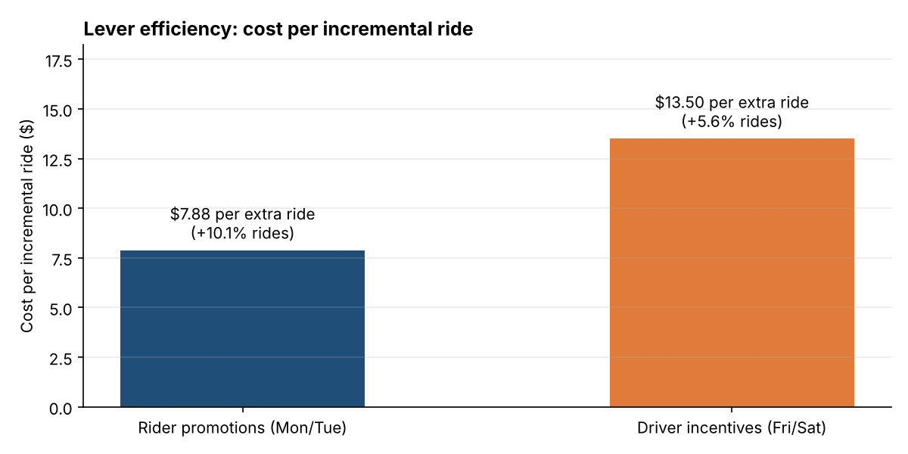
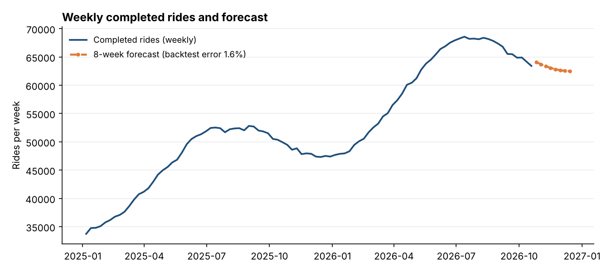
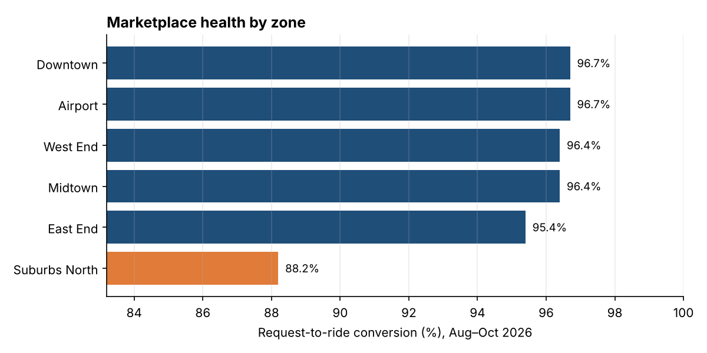
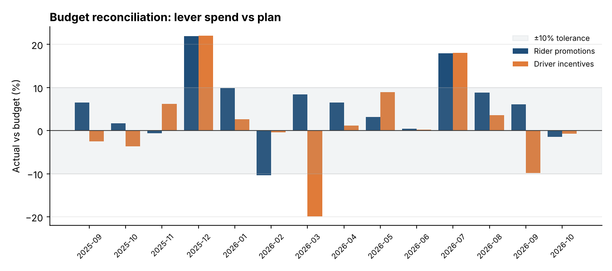

# Rideshare Marketplace Analytics

A marketplace analytics project built the way a rideshare **market management** team works:
weekly KPI reporting, measuring whether marketplace levers (rider promotions and driver
incentives) actually create extra rides, forecasting demand, reconciling lever spend against
budget, and turning it all into a **weekly business review** with recommendations.

> All data is **synthetic** (generated by `src/generate_data.py`) for a fictional city.
> No real company, rider or driver data is used.

## Business questions

1. How are rides, conversion and bookings trending week over week?
2. Which lever is more efficient: **rider promotions** or **driver incentives**?
3. Which zones have a supply gap?
4. How many rides should we expect in the next 8 weeks?
5. Is lever spend tracking the budget plan?

## Key results

| Metric | Result |
|---|---|
| Rider promotions (Mon/Tue) | **+10.1% rides**, **$7.88 per incremental ride** |
| Driver incentives (Fri/Sat) | **+5.6% rides**, **$13.50 per incremental ride** |
| Weakest zone | Suburbs North, 88.2% request-to-ride conversion, 1.10x avg surge |
| 8-week ride forecast | Backtest error (MAPE) **1.6%** |
| Budget reconciliation | 4 of 22 months outside ±10% of plan, flagged for review |

Full write-up: [`reports/findings.md`](reports/findings.md) · Weekly business review workbook: [`reports/weekly_business_review.xlsx`](reports/weekly_business_review.xlsx)






## Method

- **Data quality:** duplicate rows removed and missing gross bookings filled from zone median fare, with every fix logged ([`reports/data_quality_report.md`](reports/data_quality_report.md)).
- **SQL (SQLite):** weekly KPIs, zone health and monthly lever spend ([`sql/analysis.sql`](sql/analysis.sql)).
- **Lever impact:** **difference-in-differences**. Lever weekdays are compared with control weekdays (Wed/Thu) for 90 days before and after each launch, so overall growth and seasonality are not wrongly counted as lever impact.
- **Forecast:** linear trend plus yearly seasonality, backtested on the last 8 full weeks.
- **Budget reconciliation:** monthly actual lever spend vs plan, flagged outside a ±10% tolerance.
- **Delivery:** charts, a multi-sheet Excel weekly business review and a findings memo for leadership.

## Project structure

```
src/generate_data.py   synthetic daily marketplace data by zone + lever budget plan
sql/analysis.sql       weekly KPIs, zone health, monthly lever spend
src/analyze.py         cleaning, SQL, diff-in-diff lever impact, forecast, reconciliation, reports
run_all.py             runs the whole pipeline
```

## Skills shown

SQL (CTEs, aggregations, date logic) · Python (pandas, NumPy, Matplotlib) · causal measurement
(difference-in-differences) · forecasting and backtesting · budget reconciliation and variance
analysis · KPI design · data quality checks · business review storytelling

## How to run

```bash
pip install -r requirements.txt
python run_all.py
```
